# Klasterisasi Mata Uang terhadap SDR

[English](README.md) · **Bahasa Indonesia**

K-means mengelompokkan **155 mata uang** berdasarkan posisi kurs terhadap Special Drawing Rights (SDR) dibandingkan dengan acuan lima tahun dan satu bulan masing-masing mata uang. Model terpilih menghasilkan **dua klaster**, dengan 60 dan 95 anggota. Rupiah Indonesia (IDR) berada di Klaster 2, dengan biaya memperoleh SDR di atas acuan pada kedua periode.

## Data dan variabel

Analisis menggunakan kurs tengah harian dari Xe dalam satuan **unit mata uang lokal per SDR**. Xe menggunakan kode `XDR` untuk SDR. Berkas `data.xlsx` memuat satu baris per kode mata uang dan dua Z-score yang sudah dihitung. Seluruh 155 baris memiliki nilai yang valid untuk kedua skor. [Tabel kurs Xe untuk XDR](https://www.xe.com/currencytables/?from=XDR)

Setiap skor dihitung sebagai `(kurs yang diamati − rata-rata periode acuan) / simpangan baku periode acuan` untuk mata uang yang sama. Skor positif berarti diperlukan lebih banyak unit mata uang lokal untuk memperoleh satu SDR dibandingkan rata-rata periode acuannya. Skor negatif berarti diperlukan lebih sedikit unit, sedangkan nol berarti setara acuan. K-means langsung menggunakan kedua skor dengan jarak Euclidean tanpa penskalaan tambahan.

| Variabel | Rata-rata | Simpangan baku sampel | Minimum | Maksimum |
| --- | ---: | ---: | ---: | ---: |
| Z-score lima tahun | 0,1645 | 1,2513 | −2,5651 | 3,8890 |
| Z-score satu bulan | −0,0638 | 0,9382 | −2,9562 | 2,6344 |

Bagian tengah distribusi skor lima tahun lebih lebar. Aturan 1,5×IQR menandai **IRR** sebagai pencilan pada skor lima tahun dan **16 mata uang** pada skor satu bulan, termasuk **JPY** di sisi bawah dan **BIF** di sisi atas. Semua pencilan tetap disertakan dalam pemodelan. Korelasi peringkat Spearman kedua skor adalah **0,4958**. Mata uang dengan peringkat tinggi pada satu periode cenderung berperingkat lebih tinggi pada periode lain, meskipun beberapa mata uang seperti JPY memiliki profil yang berbeda di kedua periode.

Eksplorasi data dan korelasi (3 grafik)

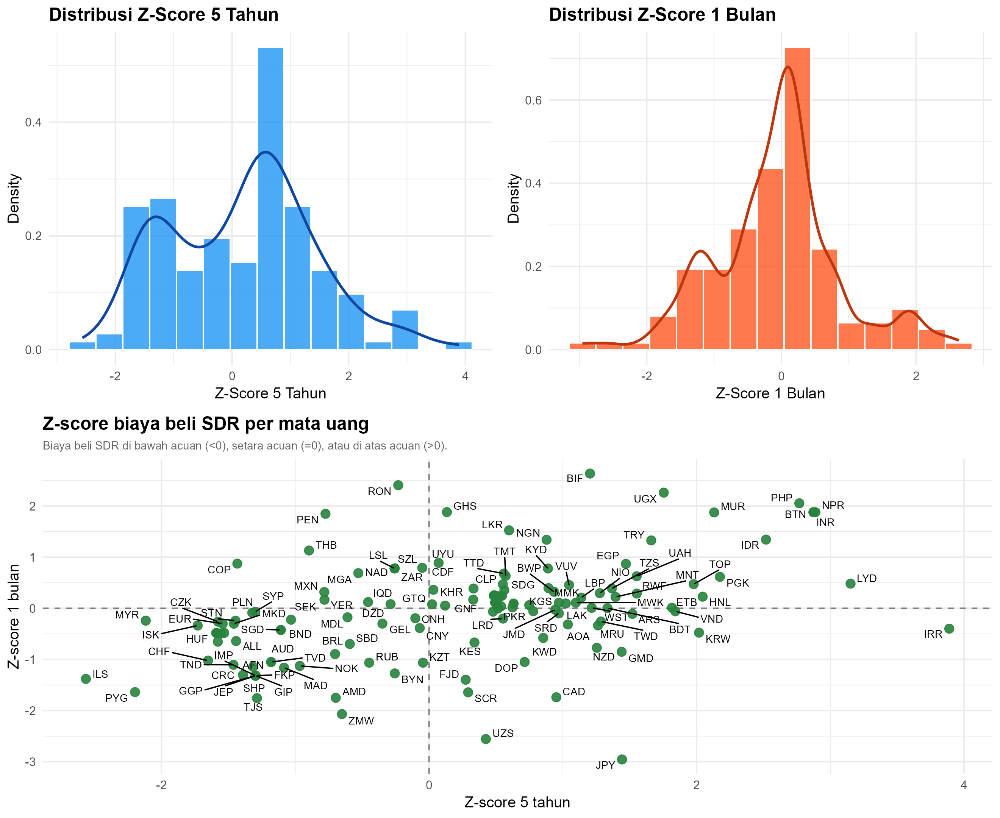

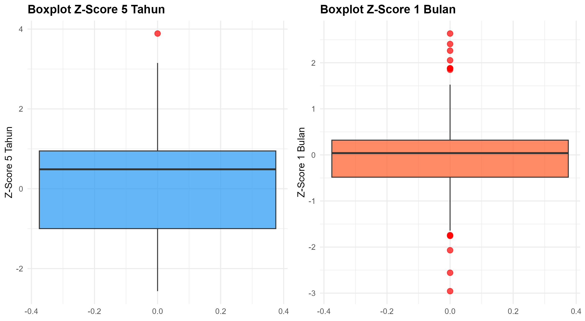

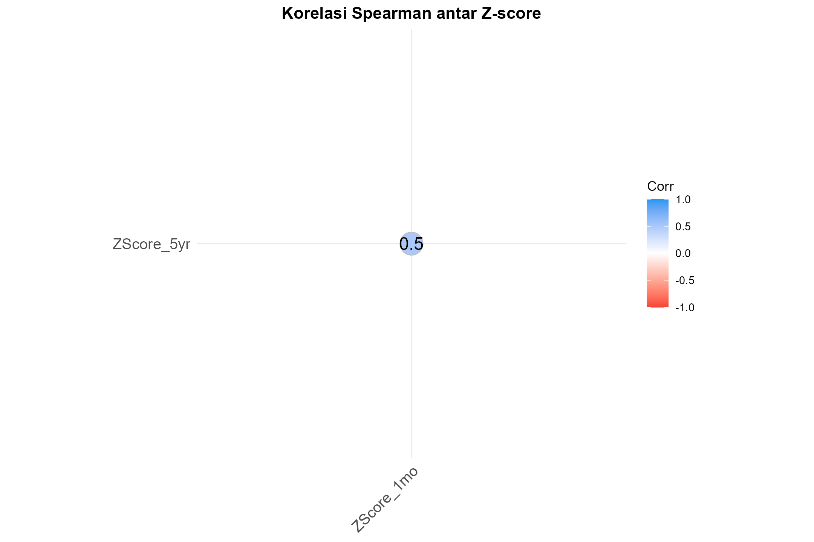

## Mengapa dua klaster?

| Diagnostik | Hasil |
| --- | --- |
| Jumlah kuadrat dalam klaster (WSS) | Penurunan terbesar terjadi dari satu ke dua klaster. WSS terus turun ketika jumlah klaster bertambah. |
| Rata-rata silhouette | Tertinggi pada `k = 2` di antara solusi dengan 2–10 klaster. |
| Gap statistic | Memilih `k = 2` dengan aturan `firstSEmax`. Nilai gap pada dua klaster adalah 0,5896, berdasarkan 50 simulasi acuan. |
| NbClust | `k = 2` mendapat suara terbanyak, yaitu 10 dari 23 rekomendasi pada rentang 2–8. Grafik Hubert dan D-index menampilkan dua diagnostik visual dari tahap ini. |

Skrip menetapkan `k = 2` setelah meninjau diagnostik, lalu menjalankan K-means dengan `set.seed(123)`, 50 inisialisasi, dan batas 100 iterasi. Statistik Hopkins **0,9073** menunjukkan kecenderungan pengelompokan pada ruang kedua skor ini. Jumlah klaster ditentukan melalui diagnostik di atas. [Dokumentasi Hopkins di R](https://search.r-project.org/CRAN/refmans/hopkins/html/hopkins.html)

Diagnostik jumlah klaster (5 grafik)

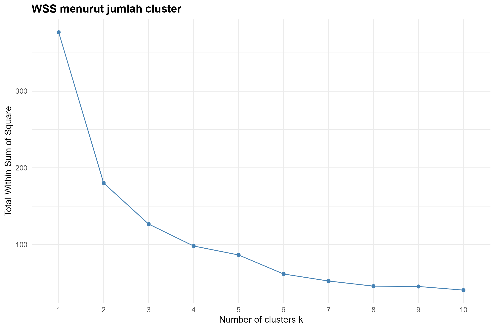

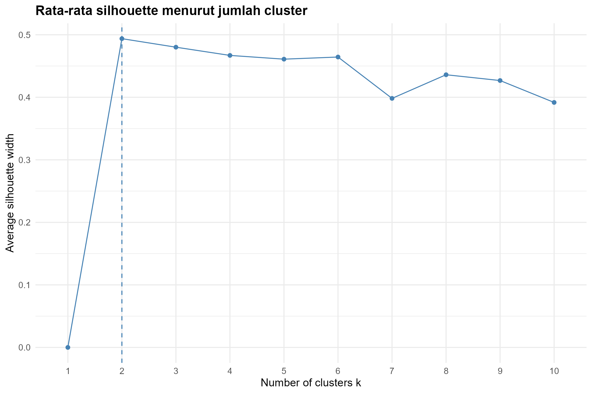

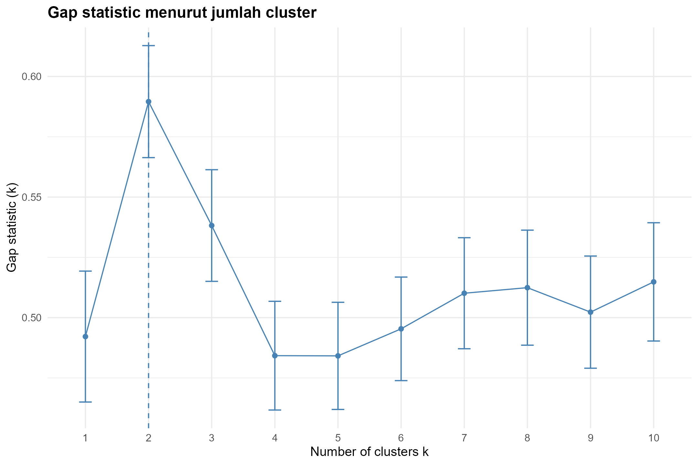

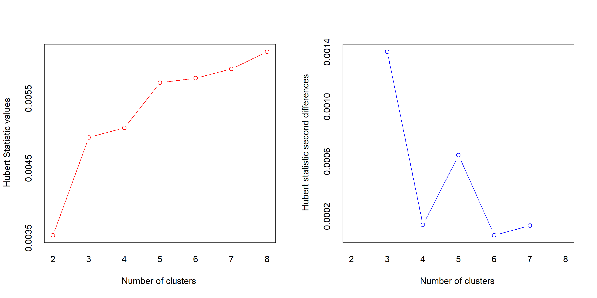

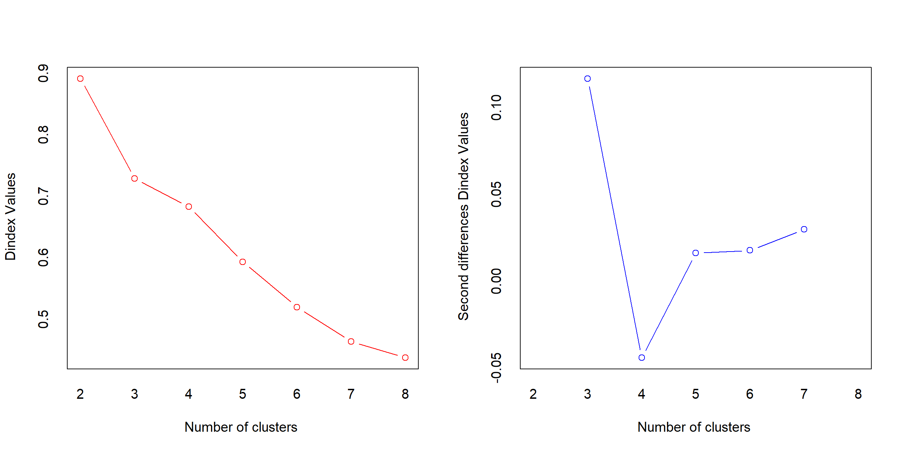

## Profil klaster dan posisi rupiah

| Klaster | Jumlah mata uang | Pusat klaster lima tahun | Pusat klaster satu bulan | Contoh anggota |
| --- | ---: | ---: | ---: | --- |
| 1 | 60 | −1,0578 | −0,7796 | EUR, GBP, AUD, SGD, JPY |
| 2 | 95 | +0,9365 | +0,3883 | IDR, INR, PHP, TRY, EGP |

Secara rata-rata, anggota Klaster 1 berada di bawah acuan masing-masing pada kedua skor, sedangkan anggota Klaster 2 berada di atas acuan. Selisih pusat klaster lebih besar pada skor lima tahun. Anggota klaster tetap dapat memiliki skor dengan tanda berbeda. JPY, misalnya, berada di Klaster 1 dengan skor lima tahun positif dan skor satu bulan yang jauh di bawah nol.

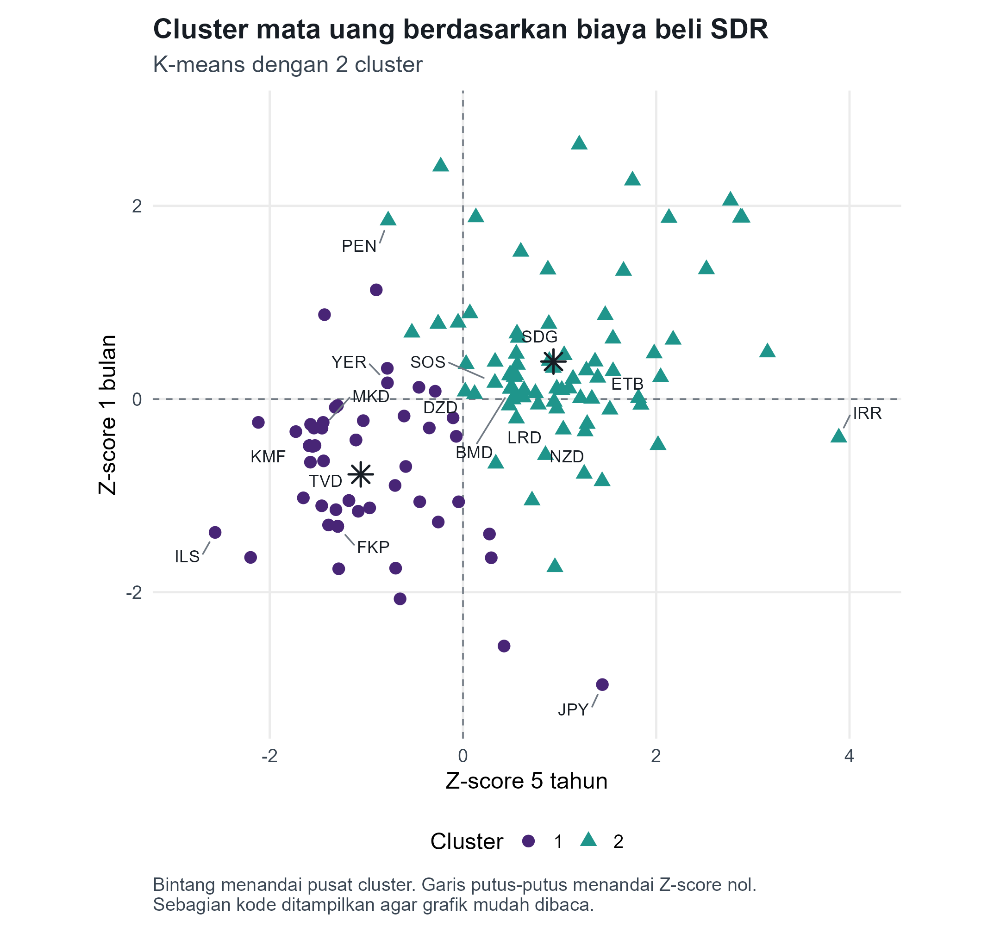

Skor IDR adalah **+2,5193 (lima tahun)** dan **+1,3437 (satu bulan)**. Berdasarkan jarak Euclidean pada kedua skor, **INR dan BTN sama-sama paling dekat dengan IDR (0,6415)**, diikuti NPR (0,6496) dan MUR (0,6575). PHP juga berada di Klaster 2, dengan jarak 0,7525. Jarak ini membandingkan dua deviasi terstandar. Kesamaan penyebab atau pergerakan kurs harian memerlukan data lain untuk diuji.

## Kualitas klaster

Rata-rata silhouette model akhir adalah **0,4938**, dengan rata-rata per klaster **0,51** dan **0,49**. Hasil ini menunjukkan pemisahan sedang. **CNH** adalah satu-satunya mata uang dengan silhouette negatif, yang berarti rata-rata jaraknya ke anggota klaster lain lebih kecil. Proporsi jumlah kuadrat antarklaster terhadap total adalah **52,14%**. Indeks Dunn adalah **0,0580**, sedangkan rasio rata-rata jarak dalam klaster terhadap jarak antarklaster (`wb.ratio`) adalah **0,4943**. [Dokumentasi `cluster.stats` di R](https://search.r-project.org/CRAN/refmans/fpc/html/cluster.stats.html)

Silhouette, ukuran klaster, profil, dan peta panas (4 grafik)

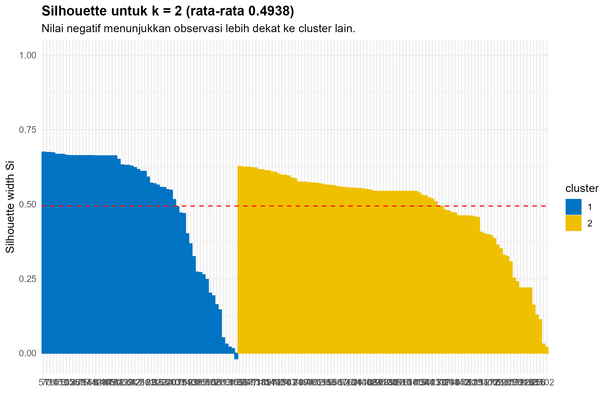

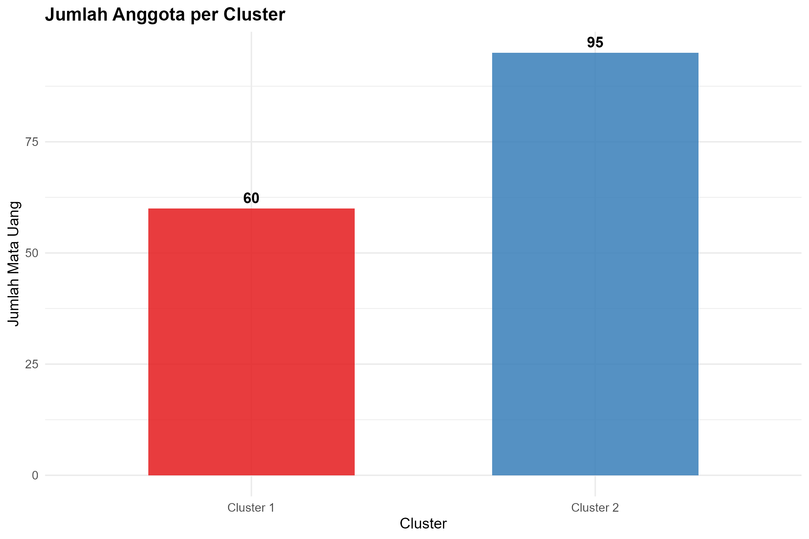

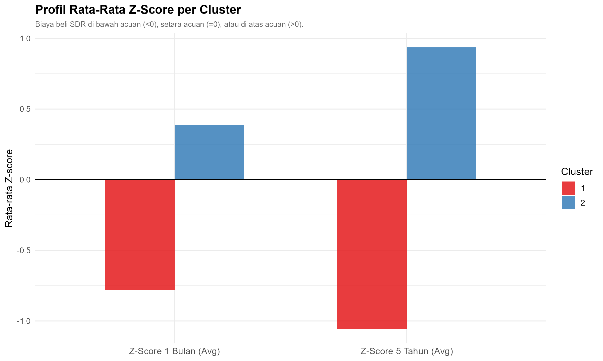

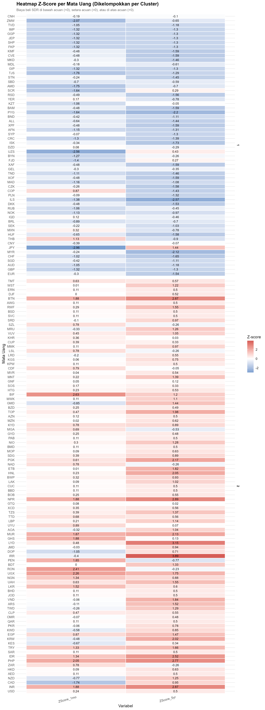

## Menjalankan analisis

1. Tempatkan `data.xlsx` dan skrip K-means dalam satu folder. Skrip lokal yang digunakan untuk hasil ini bernama `k-means.R`.
2. Buka folder di RStudio atau jadikan folder tersebut direktori kerja R. Atur `output_dir <- getwd()` di awal skrip agar hasil disimpan di sana.
3. Jalankan skrip. Skrip akan memasang paket analisis yang belum tersedia. Jika `openxlsx` terpasang, skrip menyimpan `hasil_kmeans_clustering.xlsx` yang memuat keanggotaan mata uang, pusat dan profil klaster, diagnostik, serta panduan kolom. Jika paket itu belum terpasang, data keanggotaan disimpan sebagai `hasil_kmeans_clustering.csv`.

Skrip menyimpan grafik di `visual_clustering/` dan menyalin diagram pencar akhir ke `plot_cluster_mata_uang.png`.

## Catatan analisis

Makalah *Analisis Klaster K-Means pada Nilai Tukar 155 Mata Uang terhadap Special Drawing Rights (SDR) dengan Standarisasi Z-Score* juga membahas multidimensional scaling (MDS) dan perbandingan Kruskal–Wallis setelah pengelompokan. Hasil dan grafik di sini mengikuti keluaran R, yang langsung mengelompokkan dua kolom skor asli. Perbandingan pada kedua skor yang sama menggambarkan perbedaan di antara klaster yang terbentuk.
